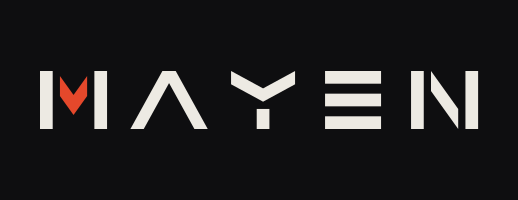

<div align="center">



**A local voice assistant that lives across your own devices.**
It listens continuously, talks to more than one person, acts on its own timers, and keeps its data on
your machines. Nothing runs in the cloud, and nothing is reachable from the internet.

</div>

<details>
<summary>Table of contents</summary>

- [What it is](#what-it-is)
- [Design rules worth knowing](#design-rules-worth-knowing)
- [Architecture](#architecture)
- [Status](#status)
- [Getting started](#getting-started)
- [Running it](#running-it)
- [Development](#development)
- [License](#license)

</details>

## What it is

Mayen is a personal assistant platform built on an STT → LLM → TTS pipeline. Most voice assistants
assume one user, one device and one conversation that the user always starts. Mayen is designed without all three
assumptions:

- **Several devices, several people.** Each device has its own session and context, so the owner can
  type on their laptop while someone else talks to a speaker in another room. People other than the
  owner can talk to it too, with limited permissions.
- **Turns don't only come from the microphone.** A turn starts from a *trigger*: a spoken request, a
  typed message, a timer, or an internal event. Each trigger has a priority, and a higher-priority
  trigger can interrupt a running turn.
- **Modules can live on different machines.** The language model, speech recognition and speech
  synthesis each run in their own process, and the core only knows their addresses. Moving a model to
  another machine is a config change.
- **Local and private.** Every model runs locally. Machines reach each other over a private network
  (LAN or Tailscale), and the structured data lives in one SQLite file.

This is the second version. The first one is archived at
[`golcuksinan/mayen-v1`](https://github.com/golcuksinan/mayen-v1); its lessons shaped most of the
rules below.

## Design rules worth knowing

Every decision lives in [`docs/ARCHITECTURE.md`](docs/ARCHITECTURE.md), together with its reason. A
rule written down without a reason tends to look like needless complexity later and gets "simplified"
away. A few of the rules shape the whole system:

| Rule | Why |
|---|---|
| **Permissions are enforced in code, not in the prompt.** Every tool declares an effect class (`READ`, `WRITE`, `EXTERNAL`, `IRREVERSIBLE`, `DANGEROUS`) and a sensitivity (`GENERAL`, `PERSONAL`). Each call is checked against the caller's role (`owner`, `acquaintance`, `system`, `unknown`) at call time | A model following instructions is not a security boundary. The tool catalog is the same for everyone, so a guest cannot talk their way into a hidden tool either |
| **Confirmation is a plan read back in full.** A risky call is held, and the assistant reads the plan back with every argument value. Silence until the timeout counts as "no", and "yes" is never matched by keyword | "Delete the note" means nothing if you can't hear *which* note. A keyword matcher hears "yes" in "yes, but not that one" |
| **Device identity comes from the network, not the client.** A connection's device is read from Tailscale, never from what the client claims to be | Anyone on the network can write a client. Without that check, any client could claim to be the owner's phone |
| **Personal content never goes to a shared device.** If a personal answer is asked for on a shared speaker, it goes to the person's own device | You can't know who is standing next to a shared speaker, or who walks in later |
| **Only the model speaks.** The system never plays a pre-written sentence. Its own voice is a set of short non-verbal sounds | Canned sentences sound wrong as soon as something unexpected happens, and they lock the assistant into one language |
| **The core loads no models.** LLM, STT and TTS are separate services behind a network address | A model that crashes or runs out of memory doesn't take the assistant down with it, and a smaller machine can use a smaller model without code changes |
| **Logs carry no content.** Logs only hold event headers. Conversation text, tool arguments and results stay in the event store | Forget and delete can reach the event store. A log full of conversations would be a second copy nobody cleans up |

The layering is enforced mechanically as well. A test walks the AST of the source and fails on any
import that the layer table in ARCHITECTURE §4 does not allow. The same test fails on SQL used outside
the storage adapter.

## Architecture

```
   mic client        terminal client        panel
        │                   │                  │       WebSocket, private network only
        ▼                   ▼                  ▼
  ┌───────────────────────────────────────────────────┐
  │ core                                              │
  │  audio pipeline · barge-in · turn-taking · tools  │  ← Pipecat
  │  sessions · triggers · permissions · confirmation │  ← Mayen
  │  skills · storage (SQLite, single owner)          │
  └──────┬───────────────────┬────────────────┬───────┘
         │ HTTP / WebSocket  │                │
         ▼                   ▼                ▼
   LLM server          STT service       TTS service
   (OpenAI-compatible) Whisper + VAD     Kokoro / Piper
```

The audio pipeline, interruption handling and the tool-calling loop come from
[Pipecat](https://github.com/pipecat-ai/pipecat), pinned to one version. Mayen adds the layer above
it: sessions, triggers, permissions, confirmation and storage. Only the `pipeline` and `app` packages
import Pipecat, so a framework upgrade touches one layer, and the permission and confirmation logic
is tested without the framework at all.

The model has two roles: a *reasoner* that decides on tool calls and a *talker* that writes the reply.
Each role maps to a model and a server slot in config. One model can play both roles, or a larger
model can reason while a smaller one talks.

## Status

Under active development, one end-to-end slice at a time. **Not ready for daily use.**

Working today:

- Text channel with a terminal client, and a voice channel with a microphone client. Both run over
  WebSocket.
- Barge-in: speaking over the assistant stops it, and the unfinished reply is not written to the
  history.
- An STT service (faster-whisper, voice activity detection) and a TTS service (Kokoro and Piper, with
  optional audio effects). Names the model marks as another language are read with that language's
  pronunciation.
- Skills: current time, notes (add, search, delete), reminders (add, list, delete).
- Permission checks, the confirmation gate, a trigger queue with priorities and interruption.
  Reminders that come due while Mayen is off still fire if they are within a tolerance.
- An event log and transcript in SQLite. Recorded turns can be replayed against today's prompt and
  model, with mocked tools.
- A read-only web panel that shows events and session states live.

Not there yet: wake word, input filtering, speaker recognition, the sandboxed `bash` skill,
forget/delete, do-not-disturb, long-term memory, vision, and desktop and phone clients. The choice of
language model is still open and will be settled by measurement. The full list of open questions is
in ARCHITECTURE §16.

## Getting started

### Requirements

- Linux
- Python 3.13 and [uv](https://docs.astral.sh/uv/)
- An OpenAI-compatible LLM server running locally, for example llama.cpp's `llama-server`. Server
  slots are supported, so each role keeps its own prompt cache.
- For voice:
  - an NVIDIA GPU with CUDA for Whisper (CPU works, slowly)
  - PortAudio for the microphone client
  - espeak-ng for the TTS service
  - Kokoro model files (`kokoro-v1.0.onnx`, `voices-v1.0.bin`) and/or Piper voices
  - headphones, because the microphone client does no echo cancellation and Mayen would otherwise
    hear itself
- Node.js, only to build the panel
- Optional: Tailscale. Without it, every connection counts as coming from a shared device.

### Installation

```sh
git clone https://github.com/golcuksinan/mayen.git
cd mayen
uv sync
cp config/mayen.yaml.example config/mayen.yaml
```

The example config explains every key. You also write two prompt files yourself, because the
persona is yours to choose:

- `config/prompts/system.txt`: the assistant's role, persona and rules
- `config/prompts/language.txt`: the language rule. `{language}` is replaced by the speaker's
  language.

Secrets never go into the YAML. The config only names the environment variable that holds a secret.

Check the setup, then create the owner. This is done once, at the machine:

```sh
export MAYEN_CONFIG=config/mayen.yaml
export MAYEN_MODEL=local        # a key under `models:` in the config
uv run mayen check
uv run mayen setup --name Ada --language English --device <tailscale-node-id>
```

`--device local` pairs this machine's own audio devices with the owner. It is a development
shortcut: in the architecture, this machine's microphone is a shared device.

A configuration error exits with code 78 (`EX_CONFIG`), so a service manager doesn't restart it in a
loop.

## Running it

**Text only:**

```sh
uv run mayen serve
uv run mayen-terminal            # in another terminal
```

**Voice:** start the two model services, each in its own environment, then the core and the
microphone client.

```sh
cp services/stt/stt.yaml.example services/stt/stt.yaml
cp services/tts/tts.yaml.example services/tts/tts.yaml
uv run --project services/stt python services/stt/main.py services/stt/stt.yaml
uv run --project services/tts python services/tts/main.py services/tts/tts.yaml
uv run mayen serve
uv run mayen-mic
```

On exit, `mayen-mic` prints how much audio was transferred. Audio is uncompressed PCM, about
256 kbit/s upstream while connected.

**Panel:**

```sh
cd panel && npm ci && npm run build
```

Then set `panel.dist` in the config and open `http://127.0.0.1:8765/panel/`. The panel only connects
from the owner's device and from the origins listed in the config, because it shows everyone's
conversations.

**Replay:**

```sh
uv run mayen replay                         # list recorded turns
uv run mayen replay <turn-id> --mocks m.yaml
```

The mocks file maps tool names to the results the model sees, so a replay never triggers a real
action. Replay opens the database itself, so it can't run while `serve` is running.

## Development

Every change has to pass these gates:

```sh
uv sync --locked
uv run ruff check
uv run ruff format --check
uv run mypy                     # strict
uv run pytest                   # fake adapters, no GPU, seconds
(cd panel && npm ci && npm run typecheck && npm run lint)
```

The code layout and the import table are in ARCHITECTURE §4. Code comments and the architecture
document are in Turkish. API names and the domain vocabulary (states, roles, effect classes) are in
English.

## License

Distributed under the Apache License 2.0. See [`LICENSE`](LICENSE).
